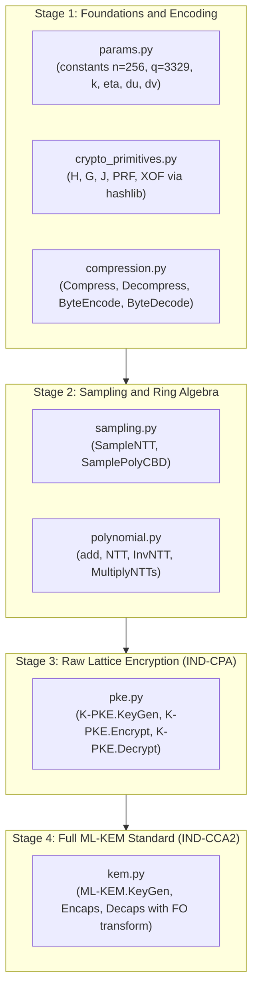

# Project Notes: Architecture, Libraries and ML-KEM Implementation Plan (FIPS 203)

This document summarizes the technical concept of the project, the role of the selected tools, and the plan for implementing **ML-KEM (Module-Lattice-Based Key-Encapsulation Mechanism)** from scratch.

---

## 1. Core idea (architecture philosophy)

The goal of the project is an **educational, from-scratch implementation of ML-KEM that is fully compliant with NIST FIPS 203**.

To combine a self-written implementation with sound software engineering, the project is strictly split into two layers:

1. **Production layer (`src/`) – "no ready-made lattice crypto":**
   All of the module-lattice math (Module-LWE), polynomial rings, the NTT, centered binomial distribution (CBD) sampling, bit compression and the Fujisaki-Okamoto transform are written by us.
2. **Verification layer (`tests/`) – differential testing:**
   Unit tests use an external reference library (`kyber-py`) purely as a **reference oracle**. This lets us check every building block we write (e.g. just `NTT` or just `Compress`) against a known-good implementation before assembling the full algorithm.

---

## 2. Selected libraries and their purpose

### A. Libraries used in the implementation (`src/`)

#### 1. `numpy` (the only external production dependency)
* **Role:** Engine for linear and polynomial algebra.
* **Use in ML-KEM:**
  * Representing polynomials from the ring $R_q = \mathbb{Z}_{3329}[X]/(X^{256} + 1)$ as 256-element integer arrays (`np.ndarray`, `int32`).
  * Representing module vectors (e.g. the secret key $\mathbf{s} \in R_q^k$ and error $\mathbf{e} \in R_q^k$) and the public matrix $\mathbf{\hat{A}} \in R_q^{k \times k}$, where $k \in \{2, 3, 4\}$.
  * Fast vectorized operations modulo $q = 3329$ and rounding in `Compress` / `Decompress`.

#### 2. `hashlib` (Python standard library)
* **Role:** Provides the **SHA-3 (Keccak / FIPS 202)** primitives that ML-KEM uses internally (FIPS 203, Section 4.1). We do not implement SHA-3 ourselves, because FIPS 203 itself treats it as an external primitive defined in a separate standard (FIPS 202).
* **Mapping of FIPS 203 functions to `hashlib`:**
  * **$H(x) \to$ `hashlib.sha3_256(x).digest()` (32 bytes):** hashing the public key $ek$ and messages.
  * **$G(x) \to$ `hashlib.sha3_512(x).digest()` (64 bytes split into $2 \times 32$):** in `KeyGen` it expands the seed $d$ into $(\rho, \sigma)$; in `Encaps` / `Decaps` it derives the shared key and deterministic randomness $(K, r)$.
  * **$J(x) \to$ `hashlib.shake_256(x).digest(32)` (32 bytes):** derives the substitute key for *implicit rejection* when the ciphertext has been tampered with.
  * **$\text{PRF}_\eta(s, b) \to$ `hashlib.shake_256(s + bytes([b])).digest(64 * eta)`:** generates pseudorandom input bytes for sampling small noise coefficients from $\text{CBD}_\eta$.
  * **$\text{XOF}(\rho, i, j) \to$ `hashlib.shake_128(rho + bytes([i, j]))`:** variable-length byte stream used by `SampleNTT` to sample the entries of $\mathbf{\hat{A}}$ via *rejection sampling*.

#### 3. `os.urandom` / `secrets` (Python standard library)
* **Role:** Cryptographically secure random number generator (CSPRNG) provided by the operating system.
* **Use in ML-KEM:** sampling the two 32-byte seeds $(d, z)$ in `ML-KEM.KeyGen` and the 32-byte random value $m$ in `ML-KEM.Encaps`.

---

### B. Libraries used only for testing and code quality (`tests/` / `dev`)

#### 4. `kyber-py` (reference oracle)
* **Role:** A pure-Python reference implementation of FIPS 203, used **only in `tests/`**.
* **Why it matters:** In cryptography a single-bit mistake (e.g. wrong little-endian bit order in `ByteEncode` or a wrong power of $\zeta$ in `NTT`) produces a completely different final key $K$, and debugging the whole algorithm blindly is extremely hard. With `kyber-py` we can:
  1. Compare the outputs of individual functions on identical inputs.
  2. Run an **interoperability test** (generate keys and encapsulate with our code from `src/`, decapsulate with `kyber-py`, and vice versa).

#### 5. `pytest`
* **Role:** Framework for running automated unit tests.
* **Use:** A single command (`pytest -v`) verifies algebraic properties (e.g. $\text{NTT}^{-1}(\text{NTT}(f)) = f$, $\text{Decompress}(\text{Compress}(x)) \approx x$, and `Decaps(Encaps(ek)) == K`).

#### 6. `ruff`
* **Role:** Linter and code formatter.
* **Use in team work:** Enforces a shared code style (PEP 8), sorts imports and catches unused variables or typos before `git commit`, reducing merge conflicts when several people work on the code.

---

## 3. How to approach ML-KEM (step-by-step roadmap)

The algorithm is built **bottom-up** in 4 stages that map to the files in `src/`:

### Stage 1: Foundations, primitives and serialization
1. **`src/params.py`** – Define the constants $n=256, q=3329$ and the parameter sets for `ML-KEM-512`, `ML-KEM-768` and `ML-KEM-1024` (FIPS 203, Table 2).
2. **`src/crypto_primitives.py`** – Wire `h_hash`, `g_hash`, `j_hash`, `prf`, `xof` to `hashlib`.
3. **`src/compression.py`** – Implement:
   * `Compress_d(x)` and `Decompress_d(y)` (rounding $\lfloor (2^d/q) \cdot x \rceil \bmod 2^d$ — use integer arithmetic, not `float`, to avoid precision errors),
   * `ByteEncode_d` (Algorithm 5) and `ByteDecode_d` (Algorithm 6) – converting an array of 256 integers to bytes and back.

### Stage 2: Polynomial sampling and fast NTT multiplication
4. **`src/sampling.py`** – Implement:
   * `SampleNTT` (Algorithm 7) – read 3 bytes at a time from the `XOF` stream and extract two 12-bit values, keeping those $< 3329$ (*rejection sampling*).
   * `SamplePolyCBD` (Algorithm 8) – sample small noise in $[-\eta, \eta]$ by subtracting the sum of $\eta$ bits from the sum of the next $\eta$ bits.
5. **`src/polynomial.py`** – The mathematical core:
   * Polynomial addition and subtraction modulo $3329$,
   * `NTT` (Algorithm 9), `InvNTT` (Algorithm 10) and `MultiplyNTTs` (Algorithm 11), using the table of 128 powers of the root of unity $\zeta = 17 \bmod 3329$.

### Stage 3: Internal encryption scheme `K-PKE` (IND-CPA)
6. **`src/pke.py`** – Combine Stage 1 and 2 building blocks into raw Module-LWE encryption:
   * `K-PKE.KeyGen` (Algorithm 13): generate $\mathbf{\hat{A}}$, vectors $\mathbf{s}, \mathbf{e}$ and compute $\mathbf{\hat{t}} = \mathbf{\hat{A}} \circ \text{NTT}(\mathbf{s}) + \text{NTT}(\mathbf{e})$.
   * `K-PKE.Encrypt` (Algorithm 14): compute $(\mathbf{u}, v)$ with added noise $\mathbf{e_1}, e_2$ and the scaled message $\text{Decompress}_1(m)$, then compress them.
   * `K-PKE.Decrypt` (Algorithm 15): decompress $(\mathbf{u}, v)$, compute $w = v - \mathbf{s}^T \circ \mathbf{u}$ and recover the message bits via $\text{Compress}_1(w)$.

### Stage 4: Full `ML-KEM` mechanism (Fujisaki-Okamoto transform)
7. **`src/kem.py`** – Wrap `K-PKE` with protection against active attacks (IND-CCA2):
   * `ML-KEM.KeyGen` (Algorithms 16 / 19): append the public key $ek$, its hash $H(ek)$ and a 32-byte rejection secret $z$ to the decapsulation key.
   * `ML-KEM.Encaps` (Algorithms 17 / 20): sample $m$, compute $(K, r) = G(m \parallel H(ek))$ and encrypt $c = \text{K-PKE.Encrypt}(ek, m, r)$.
   * `ML-KEM.Decaps` (Algorithms 18 / 21): decrypt $m'$, re-encrypt $c' = \text{K-PKE.Encrypt}(ek, m', r')$ and compare $c == c'$. If they differ, return the fallback key $J(z \parallel c)$.

---

## 4. Proposed split of work for 3 people

Because `src/` is split into separate modules, all three team members can work in parallel on separate Git branches:

* **Person 1 (Algebra and NTT module):**
  * Owns `src/params.py` and `src/polynomial.py` (`poly_add`, `poly_sub`, `ntt`, `inv_ntt`, `multiply_ntts`) + tests in `tests/test_polynomial.py`.
* **Person 2 (Sampling, primitives and compression module):**
  * Owns `src/crypto_primitives.py`, `src/sampling.py` (`sample_ntt`, `sample_poly_cbd`) and `src/compression.py` (`compress`, `decompress`, `byte_encode`, `byte_decode`) + tests in `tests/test_sampling_compression.py`.
* **Person 3 (K-PKE and ML-KEM protocol module):**
  * Owns `src/pke.py` and `src/kem.py` (vector/matrix logic and the Fujisaki-Okamoto transform) + integration and interoperability tests in `tests/test_kem.py`.
